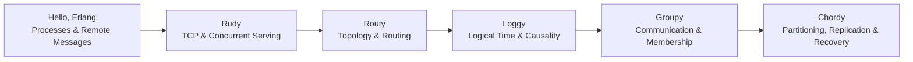
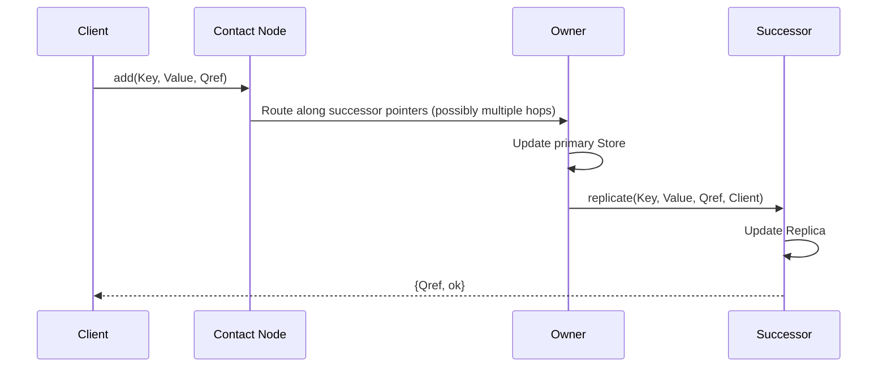

<div align="center">

[简体中文](README.zh-CN.md) · **English**

# Distributed Systems, Built from Scratch

### Turning distributed systems concepts into working protocols with Erlang.

From TCP connections to distributed storage. From a single message to state recovery after failure.<br>
**5 core assignments · 2 four-stage protocol implementations · 1 distributed benchmarking toolkit**


[Assignments](#assignment-guide) · [Tech Stack](#tech-stack-at-a-glance) · [Implementation](#inside-the-implementations) · [Quick Start](#quick-start) · [Benchmarks](#distributed-benchmarks)

</div>

---

Networks introduce delays. Messages arrive out of order. Nodes crash. How does a system keep working together?

This repository follows a practical path from **concurrent programming to distributed protocol design**: parsing HTTP and building a worker pool, implementing link-state routing and logical clocks, then developing a group membership service and a distributed hash table with successor replication. The protocols are expressed through Erlang processes, messages, and explicit state transitions. Experiment reports sit alongside the source, connecting implementation details with design decisions and failure analysis.

## Tech Stack at a Glance

| Layer | Technologies / Mechanisms | Where They Appear |
| :--- | :--- | :--- |
| **Language & Runtime** | Erlang / OTP, BEAM | Functional programming, pattern matching, lightweight processes, recursive state loops |
| **Concurrency & Failure Detection** | Actor model, `spawn`, `receive`, `monitor`, `spawn_link` | Concurrent requests, neighbor monitoring, leader failure detection and recovery experiments |
| **Networking** | `gen_tcp`, HTTP/1.0 & HTTP/1.1 GET, Distributed Erlang, `rpc` | TCP web serving, messages between nodes, remote execution and test coordination |
| **Algorithms & Protocols** | Dijkstra, link-state flooding, vector clocks, leader election, DHT | Routing, causal relationships, group communication and key partitioning |
| **Data & Replication** | Circular keyspace, interval partitioning, handover, successor replication | Data migration during joins, successor backups and takeover logic |
| **Experiments & Visualization** | `timer:tc`, monotonic clocks, fixed random seeds, wx GUI | Phase timing, response validation and color-based group state visualization |

**The core implementations use modules bundled with Erlang/OTP.** Groupy's graphical demo additionally requires an OTP installation with the `wx` application and a desktop display environment.

## Assignment Guide

| Project | The Question | Implementation Highlights | Source / Report |
| :--- | :--- | :--- | :--- |
| **Hello, Erlang** | How do two Erlang nodes communicate? | Registered processes, remote Ping/Pong, direct PID replies and timeouts | [Source](hello%2Cerlang/) |
| **Rudy** | How can a web server handle connections concurrently? | HTTP parsing, a worker pool sharing a listening socket and worker replacement | [Source](Rudy/) · [Report](Rudy/report.md) |
| **Routy** | How does a node choose the next hop from a changing topology? | Link-state flooding, sequence tracking, Dijkstra routing tables and neighbor monitoring | [Source](Routy/) · [Report](Routy/report.md) |
| **Loggy** | Does log arrival order reflect event order? | Vector clocks, clock merging, log buffering and causality experiments under jitter | [Source](Loggy/) · [Report](Loggy/report.md) |
| **Groupy** | How does a group handle new members and a crashed leader? | Membership views, leader election, message sequencing, retransmission and a GUI demo | [Source](Groupy/) · [Report](Groupy/report.md) |
| **Chordy** | How are keys distributed across a ring of nodes? | Ring maintenance, request routing, data migration, successor replication and distributed benchmarks | [Source](Chordy/) · [Report](Chordy/report.md) |



## Inside the Implementations

### Rudy · From Connections to Concurrent Serving

Starting with TCP sockets, Rudy parses GET request lines, HTTP versions and headers, then constructs a response. The current server uses a **fixed-size worker pool**: workers accept connections on the same listening socket, while a managing process monitors them and spawns replacements on `DOWN` messages.

- **Concurrency models:** The report compares sequential serving, spawning a process per request and a worker pool.
- **Controlled workload:** The response path includes an artificial `40 ms` delay to explore how service wait time affects concurrent handling.
- **Start reading:** [`rudy_server.erl`](Rudy/rudy_server.erl), [`http.erl`](Rudy/http.erl), [`test.erl`](Rudy/test.erl).

### Routy · Routing Driven by Topology Changes

Each router is an independent process maintaining interfaces, link-state history, a topology map and a next-hop table. New link-state messages pass a sequence check before being forwarded and triggering local route recomputation. When a neighbor process exits, the router updates its interfaces and broadcasts the change.

| Module | Responsibility |
| :--- | :--- |
| [`routy.erl`](Routy/routy.erl) | Router state machine and message forwarding |
| [`dijkstra.erl`](Routy/dijkstra.erl) | Shortest paths and next hops using hop count |
| [`hist.erl`](Routy/hist.erl) | Link-state sequence checks and stale-message filtering |
| [`intf.erl`](Routy/intf.erl) / [`map.erl`](Routy/map.erl) | Neighbor interfaces and topology representation |

### Loggy · Exploring Causality in Logs That Arrive Out of Order

Four workers exchange messages and send their send/receive events to a logger. Configurable send intervals and jitter make it possible to observe how delays change log arrival order.

- **Time models:** The report compares logging without logical time, Lamport time and vector clocks. The current source uses vector clocks.
- **Event tracking:** Sending increments the local component; receiving merges the remote clock and increments the local component.
- **Logging pipeline:** The logger maintains per-node clocks and a buffer, with an experimental check for when to release events.
- **Start reading:** [`time.erl`](Loggy/time.erl), [`my_logger.erl`](Loggy/my_logger.erl), [`worker.erl`](Loggy/worker.erl).

### Groupy · Four Versions of Group Communication

A single leader coordinates multicast, and workers update their color state in response to messages. The wx windows make protocol behavior observable: logs and window states help inspect joins, message propagation and failover.

| Version | Added Mechanisms | The Question It Explores |
| :--- | :--- | :--- |
| [`gms1`](Groupy/gms1.erl) | Leader forwarding, multicast and membership views | How do we organize a group that accepts new members? |
| [`gms2`](Groupy/gms2.erl) | Leader monitoring and election | Who takes over when the coordinator exits? |
| [`gms3`](Groupy/gms3.erl) | Sequence numbers, duplicate filtering and `Last` replay | What if the leader crashes partway through a broadcast? |
| [`gms4`](Groupy/gms4.erl) | Gap detection, resend requests, history buffering and a pending map | How can later messages reveal a gap and trigger retransmission? |

`gms4` retains the most recent **100 messages**. The broadcast paths in `gms2`–`gms4` include random crash injection for recovery experiments. The report also examines protocol limits under partitions, false suspicions and consecutive failures.

### Chordy · From a Ring to Replicated Key-Value Storage

Each node owns **`(PredecessorId, Id]`** in a circular keyspace. A client can contact one node and have its request forwarded along successor pointers to the owner. When a new node joins, existing data is partitioned and the appropriate entries are handed over.

| Version | Added Capabilities | Core Mechanisms |
| :--- | :--- | :--- |
| [`node1`](Chordy/node1.erl) | Ring construction and maintenance | Stabilization, predecessor / successor pointers, circular intervals and probes |
| [`node2`](Chordy/node2.erl) | Storage and lookup on the ring | Key-value storage, request references, hop-by-hop routing and handover |
| [`node3`](Chordy/node3.erl) | Neighbor failure detection and ring repair | Process monitors, a backup successor and topology repair |
| [`node4`](Chordy/node4.erl) | Successor replication and recovery logic | Primary / replica separation, acknowledgement after replication and replica promotion |

The write path in `node4` captures a concrete design decision: **the owner updates its primary store, then its successor saves the replica and replies directly to the client.** This ties successful acknowledgement to replica processing and makes the interaction between joins, migration and recovery a central topic for analysis.



## Quick Start

Install Erlang/OTP and make sure `erl` is available in your terminal. After cloning, **run each assignment from its own directory in a separate Erlang shell**. Several directories contain modules named `test` or `worker`; separate shells avoid module-loading conflicts.

```bash
git clone https://github.com/waku-hoomi/Distributed-system.git
cd Distributed-system
```

### Start a Web Server

Enter `Rudy`, launch `erl`, then run:

```erlang
c(http).
c(rudy_server).
c(test).
rudy_server:start(8080, 8).
```

Open <http://localhost:8080/hello> in your browser to see a response containing the requested path. With the server running, execute `test:bench("localhost", 8080).` in the shell to measure the total time for **100 sequential requests**, returned in microseconds.

### Build a Three-Node DHT

In a new terminal, enter `Chordy` and launch `erl`:

```erlang
c(key).
c(storage).
c(node4).
c(test).

A = node4:start(100000000).
B = node4:start(400000000, A).
C = node4:start(700000000, A).

timer:sleep(5000).
A ! probe.
```

Check that the probe output contains the expected **3 members**. The fixed wait allows time for stabilization; inspect the membership output before proceeding with writes and reads:

```erlang
ok = test:add(200000000, hello_distributed_world, A).
{200000000, hello_distributed_world} = test:lookup(200000000, C).

%% Clean up after the demo
[exit(P, kill) || P <- [A, B, C]].
```

<details>
<summary><strong>Expand: Run the Loggy and Groupy demos</strong></summary>

**Loggy:** Enter `Loggy`, start a separate `erl` shell and run a logging experiment lasting approximately five seconds. The arguments set the upper bounds for random waits and jitter, respectively, in milliseconds.

```erlang
c(time).
c(my_logger).
c(worker).
c(test).
test:run(1000, 100).
```

**Groupy:** Enter `Groupy` and start a separate `erl` shell in a desktop environment with wx support. The baseline example below opens three windows showing their color states. Replace `gms1` with another compiled version to explore its failure-handling mechanisms.

```erlang
c(gui).
c(worker).
c(test).
c(gms1).
W1 = test:first(1, gms1, 1000).
W2 = test:add(2, gms1, W1, 1000).
W3 = test:add(3, gms1, W1, 1000).
```

For Routy's topology setup, message routing and failure simulation, see the [experiment report](Routy/report.md#automated-test-script). For Ping/Pong between two Erlang nodes, start with [`pingpong.erl`](hello%2Cerlang/pingpong.erl).

</details>

## Distributed Benchmarks

[`multibench.erl`](Chordy/multibench.erl) extends DHT experiments to **4 client Erlang VMs and up to 4 storage Erlang VMs**. One client also acts as the coordinator. Requests are sequential within each client, while the four clients run concurrently.

| Dimension | Experiment Setup |
| :--- | :--- |
| Storage scale | 1 / 2 / 4 ring members |
| Entry-point placement | Shared contact / contacts spread across storage nodes |
| Workload size | 4,000 / 10,000 requests per phase |
| Phase coordination | Finish the write phase before starting the lookup phase |
| Correctness checks | Write errors, timeouts, missing values and incorrect returned values |
| Metrics | Phase duration, successful operations per second and per-client statistics |
| Reproducibility | Fixed random seeds per client; coordinator timing with a monotonic clock |

The **[distributed benchmark guide](Chordy/multibench_commands.md)** includes deployment steps, five configurations, timeout settings and cleanup commands. It uses `node2` by default; switch to `node4` and record the configuration when measuring replication overhead. Record Erlang VM counts, physical machine counts and request counts separately so the results can be interpreted correctly.

## Design Tradeoffs and Next Steps

These implementations focus on coursework experiments and understanding protocols. They also expose clear opportunities for further work:

- **Routing efficiency:** Chordy currently follows successor pointers, requiring up to `O(n)` hops. Finger tables are a possible next optimization.
- **Replication and recovery:** Replicas are held in memory. Concurrent joins, migration, recovery and partitions need more complete coordination protocols.
- **Group communication:** Groupy's bounded retransmission history and leader transitions provide a basis for failure experiments. Majority confirmation and leadership terms remain extensions.
- **Causal logging:** Vector clocks carry causal information. Loggy's safe-delivery check and ordering of concurrent events need further validation.

## Repository Structure

```text
Distributed-system/
├── hello,erlang/  # Hello World and remote Ping/Pong
├── Rudy/         # HTTP parsing, TCP serving and a worker pool
├── Routy/        # Link-state routing and Dijkstra
├── Loggy/        # Vector clocks and logging experiments
├── Groupy/       # gms1 → gms4, workers and wx GUI
└── Chordy/       # node1 → node4, key-value storage and distributed benchmarks
```

Each core assignment includes a `report.md` covering design, experimental observations and improvement ideas. Start with the system that interests you, then follow its protocol evolution alongside the source.
