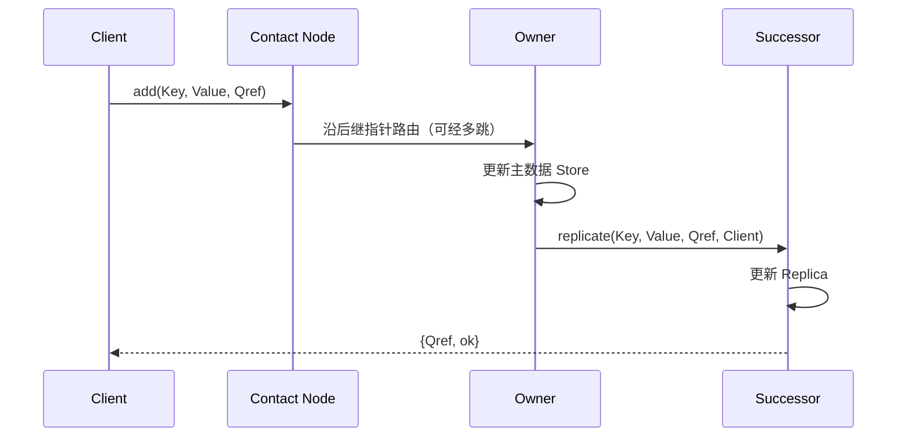

<div align="center">

**简体中文** · [English](README.en.md)

# Distributed Systems, Built from Scratch

### 用 Erlang，把分布式系统从概念写成协议。

从 TCP 连接到分布式存储，从一次消息传递到故障后的状态恢复。<br>
**5 个核心作业 · 2 条四阶段协议演进路线 · 1 套跨节点基准测试工具**


[作业导航](#作业导航) · [技术栈](#技术栈一眼看懂) · [实现亮点](#深入实现) · [快速运行](#快速运行) · [基准测试](#跨节点基准测试)

</div>

---

网络会延迟，消息会乱序，节点会崩溃。系统如何继续协作？

这个仓库记录了一条从**并发编程到分布式协议设计**的实践路线：手写 HTTP 解析与 Worker Pool，实现链路状态路由和逻辑时钟，再逐步构建组成员服务与带后继副本的分布式哈希表。核心协议通过 Erlang 进程、消息和显式状态转换展开，源码旁附有实验报告，方便同时阅读实现、设计取舍与故障分析。

## 技术栈，一眼看懂

| 层次 | 技术 / 机制 | 在仓库中的应用 |
| :--- | :--- | :--- |
| **语言与运行时** | Erlang / OTP、BEAM | 函数式编程、模式匹配、轻量级进程、递归状态循环 |
| **并发与故障感知** | Actor Model、`spawn`、`receive`、`monitor`、`spawn_link` | 并发请求处理、邻居监控、Leader 故障检测与恢复实验 |
| **网络通信** | `gen_tcp`、HTTP/1.0 & HTTP/1.1 GET、Distributed Erlang、`rpc` | TCP Web 服务、跨节点消息、远程执行与测试协调 |
| **算法与协议** | Dijkstra、Link-State Flooding、Vector Clocks、Leader Election、DHT | 路由计算、因果关系建模、组通信与键值分片 |
| **数据与副本** | 环形键空间、区间划分、Handover、Successor Replication | 节点加入时的数据迁移、后继副本与故障接管逻辑 |
| **实验与展示** | `timer:tc`、单调时钟、固定随机种子、wx GUI | 分阶段性能测量、返回值校验、组状态颜色可视化 |

**核心依赖为 Erlang/OTP 自带模块。** Groupy 的图形演示额外需要安装环境包含 OTP `wx` 应用，并具备桌面显示环境。

## 作业导航

| 项目 | 解决的问题 | 值得看的实现 | 源码 / 报告 |
| :--- | :--- | :--- | :--- |
| **Hello, Erlang** | 两个 Erlang 节点如何对话？ | 注册进程、远程 Ping/Pong、通过 PID 直接回复、超时处理 | [源码](hello%2Cerlang/) |
| **Rudy** | 如何让 Web 服务同时处理多个连接？ | 手写 HTTP 解析、共享监听 Socket 的 Worker Pool、Worker 异常补位 | [源码](Rudy/) · [报告](Rudy/report.md) |
| **Routy** | 每个节点如何根据拓扑选择下一跳？ | 链路状态泛洪、序列号去重、Dijkstra 路由表、邻居故障感知 | [源码](Routy/) · [报告](Routy/report.md) |
| **Loggy** | 日志到达顺序能否代表事件发生顺序？ | 向量时钟、时钟合并、日志缓冲、随机延迟下的因果关系实验 | [源码](Loggy/) · [报告](Loggy/report.md) |
| **Groupy** | 成员加入、Leader 崩溃后，组如何继续协作？ | 成员视图、Leader 选举、消息序列号、缺口重传、GUI 状态演示 | [源码](Groupy/) · [报告](Groupy/report.md) |
| **Chordy** | 键值如何分布到环上的多个节点？ | 环维护、请求路由、数据迁移、后继副本、跨节点基准测试 | [源码](Chordy/) · [报告](Chordy/report.md) |


## 深入实现

### Rudy · 从连接处理到并发服务

从 TCP Socket 开始，解析 GET 请求行、HTTP 版本与请求头，再构造响应。当前服务器使用**固定大小的 Worker Pool**：多个 Worker 在同一个监听 Socket 上接收连接；管理进程监控 Worker，并在收到 `DOWN` 后创建替代进程。

- **并发模型演进：** 报告比较顺序处理、每请求创建进程和 Worker Pool 三种方案。
- **可控实验负载：** 响应路径保留 `40 ms` 人工延迟，用于观察服务等待对并发处理的影响。
- **关键入口：** [`rudy_server.erl`](Rudy/rudy_server.erl)、[`http.erl`](Rudy/http.erl)、[`test.erl`](Rudy/test.erl)。

### Routy · 让拓扑变化驱动路由变化

每个 Router 都是独立进程，维护邻接接口、链路状态历史、网络拓扑与下一跳表。新的链路状态消息经序列号检查后继续传播，并触发本地路由重算；邻居进程退出时，Router 更新接口并广播变化。

| 模块 | 职责 |
| :--- | :--- |
| [`routy.erl`](Routy/routy.erl) | 路由进程状态机与消息转发 |
| [`dijkstra.erl`](Routy/dijkstra.erl) | 按跳数计算最短路径与下一跳 |
| [`hist.erl`](Routy/hist.erl) | 链路状态序列号检查，过滤旧消息 |
| [`intf.erl`](Routy/intf.erl) / [`map.erl`](Routy/map.erl) | 邻接接口管理与拓扑表示 |

### Loggy · 在乱序到达的日志中观察因果关系

四个 Worker 相互发送消息，并把发送与接收事件交给 Logger。通过可配置的发送间隔和 Jitter，观察网络延迟如何打乱日志的到达顺序。

- **时间模型：** 报告对比无逻辑时间、Lamport 时间与向量时钟；当前代码采用向量时钟。
- **事件建模：** 发送时递增本地分量，接收时合并远端时钟并递增本地分量。
- **日志管线：** Logger 维护节点时钟与缓冲队列，实验性地判断日志的输出时机。
- **关键入口：** [`time.erl`](Loggy/time.erl)、[`my_logger.erl`](Loggy/my_logger.erl)、[`worker.erl`](Loggy/worker.erl)。

### Groupy · 用四个版本拆解组通信的难点

以单 Leader 为中心组织组播，让多个 Worker 按消息更新颜色状态。wx 窗口把协议行为变成可观察的结果：成员加入、消息传播与故障切换都能通过运行日志和窗口状态检查。

| 版本 | 引入的机制 | 探索的问题 |
| :--- | :--- | :--- |
| [`gms1`](Groupy/gms1.erl) | Leader 转发、组播与成员视图 | 如何组织一个动态加入的组？ |
| [`gms2`](Groupy/gms2.erl) | Leader 监控与重新选举 | 协调者退出后由谁接管？ |
| [`gms3`](Groupy/gms3.erl) | 消息序列号、重复过滤、`Last` 重播 | Leader 只广播一部分消息就崩溃怎么办？ |
| [`gms4`](Groupy/gms4.erl) | 缺口检测、重传请求、历史缓存与 Pending Map | 收到后续消息时，如何请求补齐缺失消息？ |

`gms4` 保留最近 **100 条**历史消息；`gms2`–`gms4` 的广播路径包含随机崩溃注入，方便探索恢复行为。报告进一步讨论网络分区、误判与连续故障带来的协议边界。

### Chordy · 从一个环，演进到带副本的键值存储

每个节点负责环形键空间中的 **`(PredecessorId, Id]`**。客户端可以从一个联系节点发起请求，由后继指针逐跳转发到负责节点；新节点加入时，原有节点切分并移交相应数据。

| 版本 | 能力演进 | 核心机制 |
| :--- | :--- | :--- |
| [`node1`](Chordy/node1.erl) | 建立并维护环 | Stabilization、前驱 / 后继、环形区间、Probe |
| [`node2`](Chordy/node2.erl) | 在环上存储和查询 | 键值存储、请求引用、逐跳路由、数据 Handover |
| [`node3`](Chordy/node3.erl) | 感知邻居故障并修复环 | Process Monitor、备用后继、故障后的拓扑调整 |
| [`node4`](Chordy/node4.erl) | 加入后继副本与恢复逻辑 | 主数据 / 副本分离、复制后确认、Replica Promotion |

`node4` 的写入确认路径体现了一个具体设计取舍：**负责节点先更新主数据，再由后继节点保存副本并直接回复客户端。** 成功响应与副本处理关联，也使节点加入、迁移和恢复之间的时序成为值得分析的重点。



## 快速运行

准备可用的 Erlang/OTP 环境，确认终端能执行 `erl`。克隆仓库后，**每个作业在自己的目录和独立 Erlang Shell 中运行**；多个目录包含同名 `test`、`worker` 模块，分开运行可避免加载冲突。

```bash
git clone https://github.com/waku-hoomi/Distributed-system.git
cd Distributed-system
```

### 先跑一个 Web 服务

终端进入 `Rudy`，执行 `erl`，然后输入：

```erlang
c(http).
c(rudy_server).
c(test).
rudy_server:start(8080, 8).
```

浏览器打开 <http://localhost:8080/hello>，即可看到包含请求路径的响应。保持服务运行，在 Shell 中执行 `test:bench("localhost", 8080).`，测量 **100 次顺序请求**的总耗时，返回单位为微秒。

### 再跑一个三节点 DHT

在新的终端进入 `Chordy` 并执行 `erl`：

```erlang
c(key).
c(storage).
c(node4).
c(test).

A = node4:start(100000000).
B = node4:start(400000000, A).
C = node4:start(700000000, A).

timer:sleep(5000).
A ! probe.
```

检查 Probe 输出是否包含预期的 **3 个成员**。固定等待只用于给稳定化留出时间；确认环成员后，再执行读写示例：

```erlang
ok = test:add(200000000, hello_distributed_world, A).
{200000000, hello_distributed_world} = test:lookup(200000000, C).

%% 演示结束后清理节点
[exit(P, kill) || P <- [A, B, C]].
```

<details>
<summary><strong>展开：运行 Loggy 与 Groupy 演示</strong></summary>

**Loggy：** 进入 `Loggy`，启动独立的 `erl`，运行约 5 秒的日志实验。两个参数分别控制随机等待和 Jitter 的上限，单位为毫秒。

```erlang
c(time).
c(my_logger).
c(worker).
c(test).
test:run(1000, 100).
```

**Groupy：** 进入 `Groupy`，在具备 wx 支持的桌面环境中启动独立的 `erl`。以下示例使用基础版本观察三个窗口的颜色状态；将 `gms1` 替换为已编译的其他版本，可探索故障处理机制。

```erlang
c(gui).
c(worker).
c(test).
c(gms1).
W1 = test:first(1, gms1, 1000).
W2 = test:add(2, gms1, W1, 1000).
W3 = test:add(3, gms1, W1, 1000).
```

Routy 的拓扑搭建、消息发送和故障模拟步骤见 [实验报告](Routy/report.md#automated-test-script)；双节点 Ping/Pong 的入口见 [`pingpong.erl`](hello%2Cerlang/pingpong.erl)。

</details>

## 跨节点基准测试

[`multibench.erl`](Chordy/multibench.erl) 将 DHT 实验扩展到 **4 个客户端 Erlang VM 与最多 4 个存储 Erlang VM**。一个客户端同时承担协调工作，各客户端内部顺序发送请求，四个客户端之间并发执行。

| 测试维度 | 实验设置 |
| :--- | :--- |
| 存储规模 | 1 / 2 / 4 个环成员 |
| 入口分布 | 共享联系节点 / 分散到不同联系节点 |
| 请求规模 | 每阶段共 4,000 / 10,000 次请求 |
| 阶段协调 | 先完成写入阶段，再统一进入查询阶段 |
| 正确性检查 | 写入错误、超时、缺失值与返回值不匹配 |
| 测量输出 | 阶段耗时、成功吞吐量、各客户端统计 |
| 可复现设计 | 每个客户端使用固定种子；协调端用单调时钟计时 |

完整部署、五组配置、超时参数与清理命令见 **[跨节点测试指南](Chordy/multibench_commands.md)**。该指南默认使用 `node2`；测试副本开销时需切换为 `node4` 并记录配置。Erlang VM 数量、物理机器数量和请求数量应分别记录，便于解释实验结果。

## 设计取舍与延伸方向

这些实现以课程实验和协议理解为目标，值得继续推进的方向也很明确：

- **路由效率：** Chordy 当前使用后继指针，最坏需 `O(n)` 跳；Finger Table 是进一步优化的方向。
- **复制与恢复：** 当前副本保存在内存中；并发加入、迁移、恢复与网络分区仍需更完整的协调协议。
- **组通信边界：** Groupy 的有限历史重传与 Leader 切换提供了故障实验基础，多数派确认和任期机制留待扩展。
- **因果日志：** 向量时钟提供因果关系信息；Loggy 的安全输出判定与并发事件排序仍需进一步验证。

## 仓库结构

```text
Distributed-system/
├── hello,erlang/  # Hello World 与跨节点 Ping/Pong
├── Rudy/         # HTTP 解析、TCP 服务与 Worker Pool
├── Routy/        # 链路状态路由与 Dijkstra
├── Loggy/        # 向量时钟与日志实验
├── Groupy/       # gms1 → gms4、Worker 与 wx GUI
└── Chordy/       # node1 → node4、键值存储与跨节点基准测试
```

每个核心作业目录均包含 `report.md`，记录设计、实验观察与改进思路。建议先从感兴趣的系统进入，再对照代码阅读协议演进过程。
